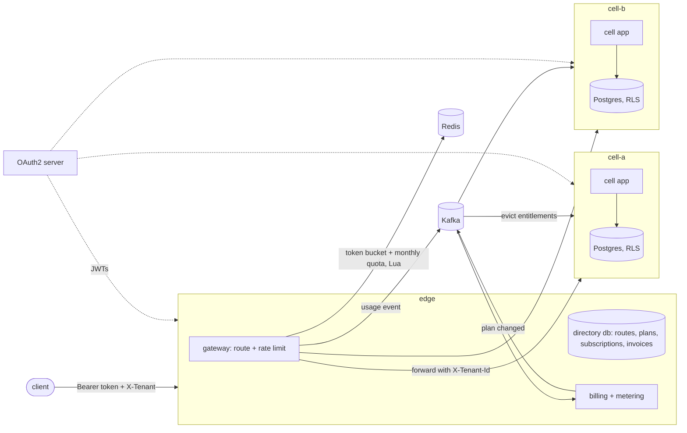

# CellForge

A multi-tenant project management backend (workspaces, members, Kanban boards, comments, billing) built
around one question: how do you stop one customer from hurting the others?

The answer here is cells. Every workspace lives in exactly one cell, an independent app plus Postgres. A
small edge service knows which cell holds which workspace, rate-limits each workspace before forwarding,
and owns billing. Inside a cell, Postgres row-level security keeps workspaces apart even if the
application forgets a `WHERE tenant_id = ...`. A workspace can be moved to another cell while it is live,
with writes paused for a fraction of a second.

I built this to practise the parts of SaaS backends that usually get skipped in tutorials: tenant
isolation that holds when the code is wrong, per-tenant limits, idempotent billing, and moving a tenant
without losing data.

## How it fits together



There is one jar with two roles, picked by `CELLFORGE_ROLE=edge|cell`. The code is hexagonal per module:
`com.cellforge.{edge,cell}.<module>.{domain,application,adapter}`. The edge has `directory`, `gateway`,
`billing` and `metering`. A cell has `tenancy`, `access` and `work`.

A request goes like this:

1. The edge checks the JWT and reads the workspace slug from `X-Tenant`.
2. It finds the workspace's cell through the directory (cached with Caffeine).
3. It spends one token from the workspace's bucket and one call from its monthly quota, both in a single
   Redis Lua call, and forwards the request to the cell.
4. The cell opens a transaction as a non-owner role and runs
   `set_config('app.tenant_id', ..., true)` and `set_config('statement_timeout', <plan budget>, true)`, so
   both settings are transaction-local and never leak through the connection pool. Every table has
   `FORCE ROW LEVEL SECURITY`.
5. The edge publishes a usage event to Kafka. Metering dedupes events by id and rolls them up per hour, and
   billing reads those totals when it closes a period.

## Running it

You need Docker with compose v2, plus `curl`, `jq` and `openssl` for the scripts. Ports 7890 (edge) and
7891 (OAuth server) must be free on localhost.

```bash
./scripts/up.sh          # builds the image, writes secrets to ~/.config/cellforge/compose.env (mode 600), waits for health
./scripts/demo.sh        # walks every feature and fails loudly if anything is off
./scripts/bench.sh       # rough latency and move numbers, see below
docker compose --env-file ~/.config/cellforge/compose.env down -v
```

There are no default passwords in the compose file. `up.sh` generates them on first run and reuses them
afterwards, so existing volumes keep working.

Tokens come from a mock OAuth2 server. Any `client_id` works and becomes the user id. The scope decides
the role: `cellforge.user`, `cellforge.internal` (cell-to-edge calls) or `cellforge.admin` (moves and
billing runs). From the host, send `Host: oauth:8080` so the issuer matches what the services expect.
`scripts/lib.sh` does this for you:

```bash
source scripts/lib.sh
T=$(token asha cellforge.user)
call "$T" "" POST /v1/tenants '{"slug": "acme", "name": "Acme", "plan": "PRO"}'
call "$T" acme POST /v1/projects '{"key": "WEB", "name": "Website"}'
```

## API

Apart from creating a workspace, every `/v1` call names its workspace with `X-Tenant: <slug>`.

| Method | Path | Notes |
|---|---|---|
| POST | `/v1/tenants` | Create a workspace and place it in the least-loaded cell. Repeating it returns the same workspace with 200 |
| GET, PATCH, DELETE | `/v1/members`, `/v1/members/{userId}` | Roles: OWNER, ADMIN, MEMBER, GUEST. The last owner can't be removed |
| POST, GET, DELETE | `/v1/invites`, `/v1/invites/{id}` | The invite token is returned once and stored hashed |
| POST | `/v1/invites/accept` | The invite's email must match the token's email |
| GET | `/v1/audit` | Admin actions, per workspace (ENTERPRISE plan) |
| POST, GET | `/v1/projects`, `/v1/projects/{id}` | Plan limit on the number of projects |
| PUT, DELETE | `/v1/projects/{id}/guests/{userId}` | Guests see only the projects they are added to (PRO and up) |
| GET | `/v1/projects/{id}/board` | ETag on the board version; `If-None-Match` gets 304 |
| GET | `/v1/projects/{id}/activity` | Latest activity, newest first (`limit`, default 50) |
| POST | `/v1/projects/{projectId}/tasks` | Optional `Idempotency-Key`; a retry replays the first response |
| GET, PATCH, DELETE | `/v1/tasks/{id}` | GET returns an ETag; PATCH with a stale `If-Match` gets 412 |
| POST | `/v1/tasks/{id}/move` | Column plus position (`afterId`), optional `If-Match`; ranks are fractional strings |
| POST, GET | `/v1/tasks/{id}/comments` | `@user` mentions notify members who can see the project |
| GET | `/v1/me/digest` | Unread notifications and assigned tasks |
| POST | `/v1/me/notifications/read` | Mark read up to a timestamp |
| GET | `/v1/billing`, `/v1/billing/invoices` | Owners and admins only |
| PUT | `/v1/billing/payment-method` | Test tokens: `tok_visa`, `tok_mastercard`, `tok_declined` |
| POST | `/v1/billing/plan` | Requires `Idempotency-Key`; upgrades are prorated |
| POST | `/webhooks/payments` | HMAC-signed provider callbacks, deduplicated by event id |
| POST | `/internal/tenants/{id}/move` | Admin scope. `{"targetCell": "cell-b"}` |
| POST | `/internal/billing/run` | Admin scope. Closes due periods now instead of waiting for the sweeper |

Errors are RFC 7807 problem details with a stable `code` such as `not-a-member`, `rate-limited`,
`quota-exhausted`, `version-mismatch`, `idempotency-key-reused` or `tenant-moving`. Rate-limited, moving
and timed-out requests carry `Retry-After`.

## Tests

```bash
mvn verify        # needs Docker for Testcontainers; about 4 minutes on my machine
```

- **Unit (41):** rank generation (jqwik properties), membership rules, role permissions, pricing (proration,
  graduated API tiers), webhook signatures, mention parsing, the per-tenant bulkhead, metering dedupe and hourly buckets,
  and 7 ArchUnit rules.
- **Integration (50, Testcontainers):** one Postgres per cell plus the directory database, Redis, Kafka and
  a mock OAuth2 server, with the edge and two cells running in the test JVM.
  - `RowLevelSecurityIT`: raw SQL as the app role can't see or write another tenant's rows, sees nothing
    with no tenant set, and can't bypass RLS; the tenant setting dies with the transaction; and freezing a
    tenant waits for a write that is already running.
  - `TenantIsolationIT`: cross-tenant ids, a forged `X-Tenant-Id`, invites used in the wrong workspace, and
    the same idempotency key in two workspaces.
  - `WorkIT`: five concurrent edits of one task version give one 200 and four 412s, and parallel retries
    with one idempotency key create one task.
  - `LimitsIT`: a burst past the bucket gets 429 while another tenant is unaffected, an exhausted monthly
    quota, a plan change reaching the cells through Kafka, and Postgres cancelling a query over the
    plan's statement budget.
  - `MeteringIT`: calls counted once when Kafka redelivers, plus a poison message that is skipped and
    logged.
  - `BillingIT`: a plan-change race with one key gives one proration invoice; four concurrent sweeps give
    one invoice per period; a declined card goes PAST_DUE, then SUSPENDED (402), then back to ACTIVE
    with a new card; forged and late webhooks are rejected or ignored.
  - `MoveIT`: data survives a move, writes during the freeze get 503 while reads still work, a stale route
    gets 421 and is followed, a failed copy rolls back, and four racing moves give one success.
  - Plus `AccessIT` and `ProvisioningIT`.

The ArchUnit rules keep `cell` and `edge` independent, keep `domain` free of Spring, Jackson and adapters,
and stop adapters of one module reaching into another. I checked that they fail by adding a class that
broke them, then deleted it.

## Measured numbers

From `scripts/bench.sh` against the compose stack, run twice on my machine. It is an 8-core, 15 GB Linux
box that was also running other projects' containers at the time, so treat these as rough. They are
single-client, sequential timings measured with curl, not a load test.

| | Run 1 | Run 2 |
|---|---|---|
| Quiet workspace, 200 board reads alone, p50 / p99 | 8.1 / 17.1 ms | 4.9 / 13.6 ms |
| Same reads while a FREE workspace hammers from 8 loops, p50 / p99 | 13.7 / 35.9 ms | 9.3 / 26.2 ms |
| Noisy workspace responses during that window | 41 × 200, 3067 × 429 | 39 × 200, 3182 × 429 |
| Writes paused while moving a workspace with 200 tasks between cells | 100 ms | 79 ms |

The quiet workspace kept getting answers, but its latency still roughly doubled. The rate limiter stops the
noisy workspace at the edge, yet every rejected request still costs the edge a JWT check and a Redis round
trip on the same few cores. In a real deployment, the edge would be scaled separately from the cells. The
demo's move of a small workspace paused writes for 114 ms.

## Design decisions

- **Billing lives at the edge, not in a cell.** Billing has to see every workspace at once, and the edge
  already holds the directory. A cell holds only customer content.
- **RLS as a second line, not the only line.** Services still check membership and permissions. RLS is there
  for the query that forgets. The app role is neither table owner nor `BYPASSRLS`, and the tenant id is a
  transaction-local setting.
- **The edge decides, the cell double-checks.** The edge turns the slug into a tenant id and passes it on as
  `X-Tenant-Id`. The cell trusts that header only on calls carrying a valid JWT, and checks membership
  itself, so a forged header from a client never gets past the edge.
- **Quota and token bucket in one Lua script.** That way two concurrent requests can't both take the last
  token, and Redis supplies the time, so edge instances with skewed clocks agree.
- **The limiter fails open.** If Redis is down, requests go through and a counter goes up. Refusing every
  customer because a rate limiter is down seemed worse than letting a burst through.
- **A bulkhead per tenant inside each cell**, sized by plan (`max_concurrent`), so one workspace can't take
  the whole connection pool.
- **Moves copy a snapshot under a write freeze** instead of using logical replication. A frozen workspace
  holds a share lock that writers must take, so a write either finishes before the export or gets a
  503 with `Retry-After`. The edge compares per-table row counts and checksums before flipping the
  route, and rolls back if anything differs.
- **Idempotency keys are stored with a request fingerprint**, so reusing a key with a different body is a
  409 instead of a silent replay.
- **Fractional ranks** for board order, so a move updates one row.
- **Plans are rows**, so limits, prices and features change without a deploy. Cells cache entitlements and
  evict them when the edge publishes a plan change.

## Where it differs from the original plan

The plan (my own project blueprint) asked for more. Each of these is a deliberate simplification:

- **Mock OAuth2 server instead of Keycloak.** Keycloak adds a heavy container and realm setup without
  changing how the services validate JWTs.
- **Pooled RLS only, no schema-per-tenant for enterprise.** A second isolation mode doubles the migration
  and move paths. RLS with forced policies already covers isolation here.
- **A Kafka consumer with a dedupe table and hourly rollup instead of Kafka Streams.** The result is the
  same (each event counted once), with less infrastructure to explain and test.
- **Moves copy a JSON snapshot instead of using logical replication.** That is simpler and fully testable,
  but it pauses writes for the whole copy, so it only suits small and medium workspaces.
- **Placement picks the accepting cell with the fewest tenants**, not first-fit-decreasing bin packing. A
  new workspace has no load history to pack by.
- **In-app digest endpoint, no email.** Sending email adds an SMTP dependency without exercising anything
  multi-tenant.
- **A fake payment provider in memory** instead of a real provider's test mode, so CI needs no account or
  network access. It still signs webhooks with HMAC and retries them.
- **Billing endpoints are per workspace (`/v1/billing/...`)** rather than `/v1/subscriptions/{id}`, because
  a workspace has exactly one subscription.
- **No frontend, Helm chart, per-tenant dashboards or k6 suite.** `bench.sh` covers the skewed-traffic
  case roughly.

## Known limitations

- The rate limiter fails open while Redis is down.
- Usage and entitlement events are best effort. If Kafka is down, calls aren't counted, and cells keep
  stale entitlements until their cache TTL expires.
- Cells trust `X-Tenant-Id` from anything that can reach them with a valid token. They should sit on a
  private network behind the edge, as they do in compose.
- Billing periods are a fixed 30 days. Every forwarded call counts as billable, including 4xx responses.
- Seats are counted when the period closes, not weighted by time. The downgrade check covers seats only.
- There is no cancel endpoint, and suspended workspaces are not invoiced.
- The fake payment provider keeps state in memory and gives up on a webhook after 3 failed deliveries.
- A move holds the whole workspace in memory, it is synchronous, and the edge-to-cell timeout (5 s) caps
  how big a workspace can be. Activity rows get new ids in the target cell.
- If activating the target fails after the route flip, nothing recovers automatically and the workspace
  stays frozen in the new cell until someone retries.
- That a freeze waits for an in-flight write is tested at the transaction level (`RowLevelSecurityIT`), not
  end to end through the move API.
- In the integration tests the edge and both cells share one JVM, so log lines show the edge's
  application name for cell work too.
